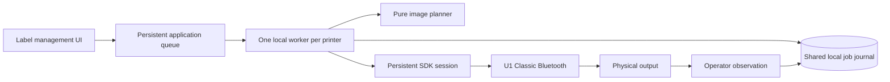

# Agent and application integration contract

[Español](INTEGRATION.es.md) · [User manual](USER_GUIDE.en.md) · [Public API](API.md)

This document is an implementation brief for an agent integrating TinyLabel into an existing label management system. Keep business templates, inventory rules, and user permissions in the host application. Use the SDK for image planning, a single printer connection, and durable attempted-job receipts. The current adapter is U1 Classic Bluetooth only; read [compatibility](COMPATIBILITY.md).

## Architecture and ownership



Run the worker on the computer with Bluetooth access. A remote web server cannot directly use a workstation's Bluetooth adapter. If exposing a local HTTP/RPC bridge, add host-appropriate authentication, explicit printer permissions, input limits, and request validation. The SDK itself starts no network server.

Use one queue, one event loop, and one `LabelPrinter` instance per printer. Keep the session open across queued jobs with identical settings. All processes using that physical printer **must share the same durable `journal_dir`**. The OS lock is scoped to that directory and resolved printer address; different directories or different computers bypass this coordination. A phone app is also outside that lock. Disconnect it explicitly.

For CLI integration, put an entire continuous batch in one invocation. Launching a new process for every image creates new sessions and requires fresh physical-origin confirmation; it loses the continuity needed to avoid mode-reset repositioning.

## Required workflow

1. Resolve the intended printer configuration, media, calibration and job IDs from trusted application state. Never choose the first Bluetooth device discovered.
2. Render each business label as a static raster image. Assign a stable per-item `label_id` using `LabelInput`.
3. Call `prepare_batch` and save previews. Preparation performs no Bluetooth/journal activity. Surface clipping and dimension errors before asking the operator to print.
4. Ask the operator to establish the physical origin and disconnect the phone app. Open a session and call `confirm_alignment` for that exact media/calibration. This acknowledgment is not homing.
5. Submit the prepared plan using a durable application `job_id`. Keep it stable across duplicate API calls and process restarts. Do not generate a new UUID on every network retry.
6. Persist the receipt in application state. On `transmitted_unconfirmed`, show “Sent; physical check required.” Do not decrement stock or mark a shipping label physically issued solely because transport succeeded.
7. Record actual observed IDs and alignment with `confirm_delivery` or `Journal.confirm`. On partial output or bad alignment, stop the queue, close, realign and authorize recovery explicitly.

Example of successive jobs in one session:

```python
from tinylabel_sdk import LabelInput, LabelPrinter, load_profile, prepare_batch
from tinylabel_sdk.errors import DeliveryUncertain, DuplicateJob

async def run_jobs(target, profile_path, jobs):
    media, calibration, options, drain = load_profile(profile_path)
    # Host UI must have obtained a real physical alignment acknowledgment.
    async with LabelPrinter(target, journal_dir="/persistent/local/label-jobs", drain=drain) as printer:
        printer.confirm_alignment(media, calibration=calibration)
        for job in jobs:  # serialized application queue, same settings
            plan = prepare_batch(
                [LabelInput(item["image_path"], item["label_id"]) for item in job["items"]],
                media, calibration=calibration, options=options,
            )
            try:
                receipt = await printer.print_batch(plan, job_id=job["job_id"])
            except DuplicateJob as error:
                # Inspect the stored receipt; this exception performs no replay.
                # Stop for reconciliation instead of guessing paper position.
                return error.receipt
            except DeliveryUncertain:
                # Queue remains paused; inspect printer.journal.get(job["job_id"]).
                raise
            # Persist receipt.to_dict(); this is not physical confirmation.
        return receipt
```

Prepare plans outside the active session where practical to reduce idle connection time. Do not mutate frozen plans or manufacture `PreparedLabel` objects: use `prepare_batch`. An async method still does CPU image preparation synchronously; use an application executor for large planning workloads before printing.

## Dimensions and calibration

Store media (`width_mm`, `height_mm`, `gap_mm`) separately from device calibration and print options. Give each accepted roll/profile an application version. Keep the profile and plan digest with business audit data. The journal stores label IDs and hashes, not source images or rendered bytes; the application must retain immutable artwork separately if recovery needs it.

The initial profile is 50 × 25 mm with a 2 mm gap. For another roll, set its measured dimensions, preview, then validate physical origin and pitch. Changing media, calibration, darkness, speed or energy after the first send requires a **new aligned session**. The SDK rejects such changes in place.

Each label boundary is calculated cumulatively:

```text
P = (height_mm + gap_mm) × motion_units_per_mm
stride(i) = round((i + 1) × P) − round(i × P)
advance(i) = stride(i) − bitmap_rows(i) × row_motion_units
```

This bounds cumulative rounding error to half a movement unit for fractional pitches. The session preserves the label index across calls. It cannot correct a wrong physical movement scale or an unmeasured gap. The 50 × 25 starting pitch is 216 units; **do not hard-code 174 rows or 42 feed units**, which only described the earlier artwork. Leading blank rows are retained for vertical placement; only trailing white rows are replaced by the calculated advance.

Print head width remains 384 dots even with a nominal 50 mm roll. The planner fits aspect ratio inside margins, centers narrower roll areas within the head, and applies offsets. A preview is a raster plan, not a measurement of paper alignment.

## Lifecycle invariants

- Initialize darkness, energy, mode and speed once per session. No per-label reset, new connection, query, or reverse movement between labels.
- Native Classic flow control must honor `AE 10` pause / `AE 00` resume. Do not replace `BluetoothTransport` with a raw socket writer that discards receive events.
- Each image gets its calculated pitch advance, including the last. There is **no additional final eject**, reverse, mode reset or `A3` status query at close. Do not append legacy helper footers.
- Wait passively until the travel estimate and quiet/flow conditions pass. Defaults use a conservative 2 mm/s assumed minimum, 5 seconds after send and 3 seconds quiet. A larger configured speed reduces waiting and increases the risk of early disconnect. These are estimates, never completion acknowledgment.
- `aclose()` disconnects only. A timeout, disconnect or cancellation can leave some/all labels printed; no automatic retry is performed. Cancellation is not a physical emergency-stop guarantee.

## Receipts, idempotency and crashes

`reserved → sending → transmitted_unconfirmed → confirmed / partial_confirmed` is the normal path. Errors during send/drain become `uncertain`. A hard process kill can leave `reserved` or `sending`; those states are also unsafe to replay.

SQLite commits the job reservation before sending. Reusing an ID always raises `DuplicateJob`, even if the payload differs or the prior attempt failed. This is **at-most-one automatic submission per ID in a preserved journal**, not exactly-once physical printing. Do not delete the journal to unblock a request. Back it up with the worker stopped; if backing up live, use SQLite's backup API rather than copying only the main file while WAL is active.

After a hard crash, stop the old worker and use `Journal.recover_interrupted(job_id)` or `tinylabel recover`. The printer lock prevents recovery against a live owner using the same journal. Recovery marks the receipt uncertain and sends nothing. Then inspect actual output and record the observed subset.

If seven of eight labels printed, record the seven IDs and `alignment_ok` truthfully. Authorize a new recovery job containing only the missing ID after physical realignment. Keep a business link from recovery to original job. A transient HTTP timeout must never trigger this recovery automatically.

`confirmed` means all IDs were explicitly recorded; check `physical_alignment_ok` independently. Partial confirmation or `alignment_ok=False` through the live client's `confirm_delivery` invalidates that session's alignment. Direct `Journal.confirm`/CLI confirmation does not update an already-running client's memory; the host must pause/close that worker itself.

## Other languages

Use [`examples/node_bridge.js`](../examples/node_bridge.js) or invoke `python -m tinylabel_sdk` with an argument array and `shell:false`. Set an explicit Python executable from your installed environment. Send the whole batch, parse stdout as JSON, keep stderr separately, and persist job ID before spawning. Do not interpolate user paths into a shell command. Use stable absolute paths for images, profile and journal. The bridge example performs a preview only.

CLI print returns code 0 with `state="transmitted_unconfirmed"`; it does not certify physical completion. Argparse errors are text on stderr; normal operation errors are JSON there. After process timeout/termination, reconcile the journal before another request. Prefer the Python API inside a persistent worker for ongoing queues; the CLI alone is not a persistent multi-request daemon.

## Agent acceptance checklist

- Pin a release; install dependencies in the worker environment; run software tests without hardware.
- Preview the actual artwork and an alternative supported roll size; reject clipping/invalid dimensions.
- Test duplicate requests with the same ID; assert no second transport call.
- Test cancellation, disconnect, crash recovery and partial physical output; never auto-resend.
- Verify one worker owns the printer, and receipts survive restarts.
- On real hardware, explicitly authorize a one-label check, a two-label batch, then a long batch. Count every label; compare first and last placement; verify the final paper boundary and the last label fully printed.
- Repeat physical acceptance for each roll/firmware/profile change before calling it supported in production.

Current software tests cover geometry, cumulative fractional pitch, frame parsing, flow/fault observation, passive drain, journal durability, exclusive ownership, cancellation, duplicate prevention, and CLI preview. They cannot establish physical long-run registration or final-label delivery.
