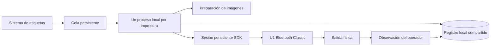

# Contrato de integración para agentes y aplicaciones

[English](INTEGRATION.en.md) · [Manual de usuario](USER_GUIDE.es.md) · [API pública](API.md)

Este documento sirve como instrucción de implementación para un agente que integre TinyLabel en un sistema de gestión de etiquetas. Conserva las plantillas, reglas de inventario y permisos en la aplicación principal. Usa el SDK para preparar imágenes, mantener una conexión y registrar intentos de impresión. El adaptador actual es únicamente U1 por Bluetooth Classic; consulta [compatibilidad](COMPATIBILITY.md).

## Integración de texto añadida en 0.2.0

La aplicación lee Excel externamente, normaliza valores a cadenas y crea objetos `TextLabel`/`TextBlock`, para ejecutar `prepare_text_batch`. También puede componer toda la cadena fuera. `format_text` es un ayudante opcional de sustitución plana; no lee hojas ni evalúa expresiones. Conserva en la aplicación ceros iniciales, formato de moneda/fecha y política de vacíos. Consulta la [guía completa](TEXT.es.md) y el [ejemplo de campos externos](../examples/text_from_fields.py).

Entrega el `BatchPlan` al mismo `LabelPrinter.print_batch` persistente; no crees otra conexión ni reinicies para imprimir texto. Para contenido mixto, `prepare_batch` acepta `TextLabel` y `LabelInput`. El texto comparte calibración/paso con imágenes y calcula avance según sus filas reales. No fijes conteos de filas de imágenes para textos. La CLI dispone de `preview-text`/`print-text` con el [ejemplo JSON](../examples/text_labels.json).

Antes de enviar, comprueba que todo cabe, revisa `text_layout` y las vistas previas, y conserva definición inmutable y versiones de fuentes en la auditoría. El registro no guarda texto fuente. Por defecto el desbordamiento se rechaza; `shrink` explícito respeta un mínimo. Campos faltantes, fuentes inválidas y texto desbordado deben informarse antes de conectar. Las pruebas de texto y regresión de imágenes corren juntas; sigue siendo necesaria la aceptación física.

## Arquitectura y control



Ejecuta el proceso en el equipo que tiene Bluetooth. Un servidor web remoto no puede usar directamente el adaptador de la computadora. Si creas un puente HTTP/RPC local, añade autenticación adecuada, permisos explícitos, límites de entrada y validación. El SDK no inicia servidores de red.

Usa una cola, un bucle de eventos y una instancia `LabelPrinter` por impresora. Mantén abierta la sesión entre trabajos con los mismos ajustes. Todos los procesos de esa impresora **deben compartir el mismo `journal_dir` persistente**. El bloqueo del sistema operativo usa ese directorio y la dirección real; otros directorios o computadoras evitan esa coordinación. La app del celular tampoco participa del bloqueo: desconéctala.

Al integrar mediante CLI, envía el lote continuo completo en una invocación. Un proceso por imagen crea sesiones nuevas y exige confirmar de nuevo el origen físico; pierde la continuidad necesaria para evitar reposicionamientos por reinicio del modo.

## Flujo obligatorio

1. Obtén impresora, papel, calibración e IDs desde el estado confiable de la aplicación. No selecciones el primer dispositivo encontrado.
2. Genera una imagen estática por etiqueta y asigna su ID del negocio con `LabelInput`.
3. Ejecuta `prepare_batch` y guarda vistas previas. No abre Bluetooth ni escribe registro. Presenta errores de geometría antes de solicitar impresión.
4. El operador alinea el origen y desconecta la app. Abre una sesión y ejecuta `confirm_alignment` con ese papel/calibración. No es una búsqueda automática del origen.
5. Envía el plan con un `job_id` persistente de la aplicación. Consérvalo ante solicitudes duplicadas y reinicios. No generes otro UUID por cada reintento de red.
6. Guarda el comprobante. En `transmitted_unconfirmed`, muestra «Enviado; requiere comprobación física». No descuentes inventario ni marques entrega física basándote solo en el transporte.
7. Registra IDs observados y alineación con `confirm_delivery` o `Journal.confirm`. Ante impresión parcial o mala posición, pausa la cola, cierra, realinea y autoriza recuperación explícita.

Ejemplo de trabajos sucesivos en una sesión:

```python
from tinylabel_sdk import LabelInput, LabelPrinter, load_profile, prepare_batch
from tinylabel_sdk.errors import DeliveryUncertain, DuplicateJob

async def procesar(target, perfil, trabajos):
    media, calibration, options, drain = load_profile(perfil)
    # La interfaz ya obtuvo confirmación real del origen físico.
    async with LabelPrinter(target, journal_dir="C:/app-data/label-jobs", drain=drain) as printer:
        printer.confirm_alignment(media, calibration=calibration)
        for trabajo in trabajos:  # cola serializada, mismos ajustes
            plan = prepare_batch(
                [LabelInput(x["image_path"], x["label_id"]) for x in trabajo["items"]],
                media, calibration=calibration, options=options,
            )
            try:
                receipt = await printer.print_batch(plan, job_id=trabajo["job_id"])
            except DuplicateJob as error:
                # Revisar lo registrado y reconciliar; no adivinar la posición.
                return error.receipt
            except DeliveryUncertain:
                # Mantener cola pausada; consultar printer.journal.get(...).
                raise
            # Persistir receipt.to_dict(); no representa confirmación física.
        return receipt
```

Cuando sea posible, prepara los planes antes de abrir la sesión. No modifiques planes inmutables ni construyas `PreparedLabel` manualmente: usa `prepare_batch`. La preparación de imágenes consume CPU de forma síncrona; para trabajos grandes usa un ejecutor de la aplicación antes de imprimir.

## Dimensiones y calibración

Guarda por separado papel (`width_mm`, `height_mm`, `gap_mm`), calibración del equipo y opciones de impresión. Versiona cada perfil aceptado y conserva perfil y huella del plan en la auditoría. El registro conserva IDs y huellas, no imágenes ni bytes renderizados; la aplicación debe retener el arte original inmutable para recuperar faltantes.

El perfil inicial es 50 × 25 mm con separación 2 mm. Para otro rollo introduce medidas reales, revisa y valida origen/paso físicamente. Cambiar papel, calibración, oscuridad, velocidad o energía después del primer envío requiere una **sesión nueva alineada**. El SDK rechaza esos cambios dentro de la sesión.

Los límites de cada etiqueta se calculan acumulativamente:

```text
P = (height_mm + gap_mm) × motion_units_per_mm
paso(i) = redondear((i + 1) × P) − redondear(i × P)
avance(i) = paso(i) − filas_bitmap(i) × row_motion_units
```

Esto limita el error de redondeo acumulado a media unidad de movimiento cuando el paso es fraccionario. La sesión conserva el índice entre llamadas. No corrige una escala física incorrecta ni una separación mal medida. El paso inicial es 216 unidades; **no fijes 174 filas ni avance 42**, que correspondían al arte anterior. Se conservan filas blancas iniciales para la posición vertical; solo las blancas finales se sustituyen por avance calculado.

El cabezal mantiene 384 puntos aunque el rollo nominal sea de 50 mm. El plan conserva proporción, respeta márgenes, centra rollos estrechos dentro del cabezal y aplica desplazamientos. La vista previa no mide la alineación física.

## Reglas del ciclo de impresión

- Inicializar oscuridad, energía, modo y velocidad una sola vez por sesión. Sin reinicio, conexión nueva, consulta o retroceso entre etiquetas.
- Respetar control de flujo Classic `AE 10` pausa / `AE 00` continuar. No sustituir el transporte por escritura cruda que descarte las notificaciones.
- Cada imagen recibe el avance calculado hasta su siguiente límite, incluida la última. **No hay expulsión adicional**, retroceso, reinicio ni consulta final `A3`. No añadas cierres de scripts anteriores.
- Esperar de forma pasiva hasta cumplir recorrido estimado y condiciones de flujo/silencio. Por defecto: mínimo supuesto 2 mm/s, 5 s después del envío y 3 s de silencio. Aumentar la velocidad mínima configurada reduce la espera y puede desconectar antes de tiempo. Nunca equivale a confirmación física.
- `aclose()` solo desconecta. Error, cancelación o tiempo agotado pueden dejar parte o todas las etiquetas impresas; no hay reintento automático. Cancelar no garantiza una parada física inmediata.

## Comprobantes, duplicados y cierres abruptos

Ruta normal: `reserved → sending → transmitted_unconfirmed → confirmed / partial_confirmed`. Errores de envío/espera producen `uncertain`. Un cierre abrupto puede dejar `reserved`/`sending`; tampoco es seguro repetirlos.

SQLite confirma la reserva antes del envío. Reutilizar un ID siempre produce `DuplicateJob`, incluso con datos diferentes o después de un fallo. Es **como máximo un envío automático por ID con el registro conservado**; no es impresión física exactamente una vez. No borres el registro para desbloquear solicitudes. Haz copias con el proceso detenido; en vivo utiliza la API de respaldo de SQLite y no copies únicamente el archivo principal mientras haya WAL.

Después de un cierre abrupto, detén el proceso viejo y usa `Journal.recover_interrupted(job_id)` o `tinylabel recover`. El bloqueo impide recuperar contra un proceso activo que comparta registro. Solo marca el trabajo incierto, sin enviar. Revisa el papel y registra el subconjunto observado.

Si salieron siete de ocho, registra los siete IDs y la alineación real. Tras realinear, autoriza otro trabajo con solo el faltante y enlázalo al original en el negocio. Un tiempo agotado de HTTP nunca debe provocar automáticamente esa reimpresión.

`confirmed` significa que se registraron todos los IDs; comprueba aparte `physical_alignment_ok`. Una confirmación parcial o `alignment_ok=False` mediante `confirm_delivery` invalida la alineación de la sesión viva. `Journal.confirm` y la CLI no actualizan la memoria de un proceso que ya esté abierto: la aplicación debe pausar/cerrar ese proceso.

## Integración desde otros lenguajes

Usa [`examples/node_bridge.js`](../examples/node_bridge.js) o invoca `python -m tinylabel_sdk` con un arreglo de argumentos y `shell:false`. Selecciona el ejecutable Python explícito del entorno instalado. Envía el lote completo, interpreta stdout como JSON, conserva stderr aparte y persiste el ID antes de lanzar el proceso. No interpolar rutas del usuario en comandos de shell. Usa rutas absolutas para imágenes, perfil y registro. El ejemplo solo genera una vista previa.

La CLI devuelve código 0 con `state="transmitted_unconfirmed"`; no confirma impresión física. Argparse puede producir texto en stderr; los errores de operación son JSON. Si matas el proceso o vence su plazo, reconcilia el registro antes de otro envío. Para colas continuas prefiere la API Python en un proceso persistente; la CLI sola no es un servicio persistente de múltiples solicitudes.

## Criterios de aceptación del agente

- Fijar versión, instalar en el proceso local y ejecutar pruebas sin hardware.
- Revisar el arte real y otro tamaño compatible; rechazar recortes y medidas inválidas.
- Duplicar una solicitud con el mismo ID y verificar que no hay segundo envío.
- Probar cancelación, desconexión, recuperación de cierre abrupto e impresión parcial; sin reenvío automático.
- Comprobar exclusión de procesos y persistencia tras reinicios.
- En hardware, autorizar explícitamente una etiqueta, luego dos y luego un lote largo. Contar todas; comparar primera/última, verificar posición final y salida completa de la última.
- Repetir aceptación física por rollo, firmware o perfil antes de declararlo apto para producción.

Las pruebas actuales cubren geometría, paso fraccionario acumulado, protocolo, flujo/errores, espera, registro, bloqueo, cancelación, duplicados y vista previa CLI. No demuestran registro físico de lotes largos ni entrega de la última etiqueta.
